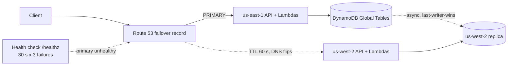

# A failover you have not run is a drawing

The December 2021 us-east-1 event is the reference story for a reason. The region's control plane was impaired along with the data plane, and services many recovery runbooks depend on, IAM and STS among them, were part of the blast radius. Teams that "had a DR plan" found the plan needed credentials and API calls that lived in the region they were trying to recover from. A diagram is not a capability. A drill is.

## Problem / Context

The system is an order checkout with shared inventory: a customer reserves stock, an order row is written as `pending`, and something later fulfills it. It runs serverless, so there is no cluster to rebuild, but the inventory count is global and correctness matters more than raw throughput.

The constraints are ordinary for a small team:

- **RTO around 5 minutes.** A region-level event stops writes and reads in the primary. Waiting hours is not acceptable.
- **RPO around seconds.** Orders and stock decrements cannot vanish in bulk.
- **Cost-conscious.** Paying for a second full-time active region is hard to justify at demo-to-modest volume.
- **Small operations team.** The failover path has to be short enough to run under pressure, and tested often enough to trust.

Active/active is the obvious answer until you look at the inventory write path. Two regions accepting decrements for the same SKU is a conflict problem, and DynamoDB Global Tables resolve conflicts with last-writer-wins, not with arithmetic.

## Solution

### Pick a tier before picking a service

| Tier | RTO | RPO | Rough cost / complexity | Data approach | Choose when |
|---|---|---|---|---|---|
| Backup and restore | Hours to days | Hours to days | Lowest steady-state cost, highest recovery effort | Restore backups into a new region | A long outage is tolerable |
| Pilot light | Tens of minutes to hours | Minutes to hours | Low idle cost, medium complexity | Data replicated; compute rebuilt on demand | Data must survive, but compute can wait |
| Warm standby | Minutes | Seconds to minutes | Roughly 2x the data layer, medium complexity | Live replica; full stack idle in the DR region | You need a short RTO and can pay for idle capacity |
| Active/active | Near zero | Near zero | Highest cost and complexity | Multi-writer or partitioned writes, plus conflict handling | Downtime is very expensive and write conflicts are solved |

This example is warm standby. The second region is fully deployed before it is needed; what stays idle is traffic, not infrastructure.

### The built design

- **DynamoDB Global Tables.** `mrf-orders` and `mrf-inventory` are created in the primary and replicated to the standby. Replication is asynchronous, typically sub-second, with no guaranteed bound.
- **Route 53 failover records.** `checkout.<domain>` has a PRIMARY CNAME to the primary's execute-api hostname and a SECONDARY CNAME to the standby's. A health check on the primary's `/healthz` gates the PRIMARY record.
- **Detection tuned to the RTO.** The check runs every 30 seconds, needs 3 consecutive failures, and the record TTL is 60 seconds. That puts detection and DNS propagation at roughly 2.5 to 3 minutes, inside the 5-minute target.
- **Single-writer discipline.** Checkout writes go to one region at a time. The standby is a failover target, not a second writer.
- **A sweeper in the standby.** An EventBridge `rate(5 minutes)` rule promotes `pending` orders through the `status-index` GSI. It is idempotent: each promotion is conditioned on `status = pending`.
- **Control-plane independence.** Run the failover from outside the primary region, with credentials that do not depend on it. That is the lesson from 2021, and it is the part most diagrams omit.

### The write path that makes it safe inside a region

The inventory decrement and the order insert are one transaction. The stock condition and the idempotency condition are both enforced by DynamoDB, so a retry cannot decrement twice and a missing SKU cannot be created with negative stock.

```python
dynamodb_client().transact_write_items(TransactItems=[
    {"Update": {
        "TableName": inventory_table, "Key": {"sku": {"S": sku}},
        "UpdateExpression": "SET quantity = quantity - :qty",
        "ConditionExpression": "attribute_exists(sku) AND quantity >= :qty",
        "ExpressionAttributeValues": {":qty": {"N": str(quantity)}},
    }},
    {"Put": {
        "TableName": orders_table, "Item": to_dynamo(order),
        "ConditionExpression": "attribute_not_exists(order_id)",
    }},
])
```

### The check that decides the flip

```hcl
resource "aws_route53_health_check" "primary" {
  type              = "HTTPS"
  fqdn              = var.primary_api_hostname
  resource_path     = "/healthz"
  request_interval  = 30
  failure_threshold = 3
  enable_sni        = true
}
```

The check targets the primary's execute-api hostname directly, not `checkout.<domain>`. Checking the name that the failover records answer would make the check depend on its own result. `enable_sni` is required because execute-api serves only its own certificate.

### The sweeper that covers the gap

```hcl
resource "aws_cloudwatch_event_rule" "sweeper" {
  count               = var.enable_sweeper ? 1 : 0
  name                = "${local.stack}-sweeper"
  schedule_expression = "rate(5 minutes)"
}
```

SQS is regional. Messages sitting in a dead region are trapped there, which is why the design does not depend on a queue for fulfillment. The sweeper runs in the standby and promotes whatever is still `pending` when it next runs.

## Diagram

[Architecture diagram: warm standby across us-east-1 and us-west-2](../diagrams/multi-region-failover.drawio)

The source opens in draw.io. Export a PNG or SVG beside it before publishing; no export is committed yet.

The short version:



Steady state sends traffic to the primary. Three failed checks mark it unhealthy, the PRIMARY record stops answering, and clients that respect the 60-second TTL land on the standby.

## Tradeoffs

- **The data layer costs roughly double.** Global Tables replicate every write and add cross-region transfer. The budget owner pays for a standby that may sit idle for months; the alternative is a longer RTO.
- **Last-writer-wins can oversell.** The conditional decrement is atomic only inside one region. Two regions can each see enough stock and accept a decrement; when replicas converge, one write to `quantity` survives and the other is lost. The reasoning is in [the example's split-brain walkthrough](../examples/multi-region-failover/README.md#split-brain-demo-the-teaching-moment) and in the docstring of `checkout.py`. This is why the design keeps a single writer.
- **There is a consistency window at cutover.** Replication is asynchronous with no bound. Writes in flight during the flip can be lost, and a read right after failover can be slightly stale.
- **Failback is not free.** Replication is bidirectional, so there is no re-seed, but the same LWW rule applies in reverse. The sweeper catches up `pending` orders on its schedule, not instantly.
- **Two stacks drift.** One shared module keeps the regional stacks similar, but the roots, state, and apply cadence are separate. IAM is account-global, so role names carry the region to avoid collisions.
- **"Warm" is about data, not compute.** Lambda cold starts are a rounding error next to replication. Pre-provisioning the second region matters because the table replica and the API exist, not because a function is kept hot.
- **The demo stops at DNS.** The records demonstrate the failover control plane, but `checkout.<domain>` needs a Regional API Gateway custom domain (ACM certificate plus API mapping) before a real client can use it. A plain CNAME to execute-api gives you a certificate mismatch and can fail Host-header routing.
- **Automated beats manual.** Mutating a health check is fine for a drill and poor for an incident. Route 53 Application Recovery Controller (ARC) routing controls give you audited, reversible traffic shifts without editing a check under pressure.
- **The drill is the maintenance cost.** Two regions, two applies, and a failover path that rots if untested. Schedule it. The runbook only counts if someone runs it from outside the primary region.

## TL;DR

- Warm standby with Global Tables and Route 53 failover buys a 2.5–3 minute detection-and-flip inside a 5-minute RTO, at roughly double the data-layer cost.
- The conditional transaction stops overselling within a region, not across replicas; Global Tables are last-writer-wins, so keep one writer and fail over rather than going active/active.
- Run the drill, and run it from outside the primary region: the December 2021 us-east-1 event took the control plane with it.
